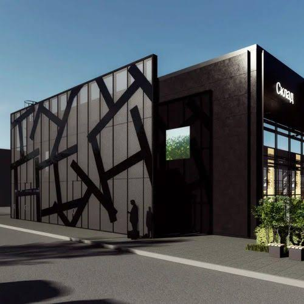
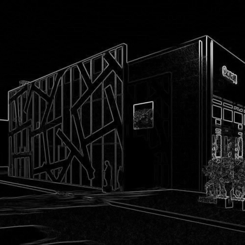
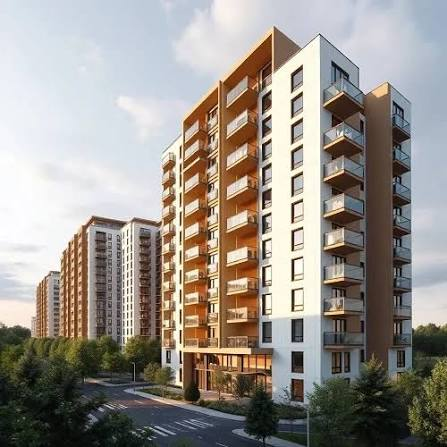
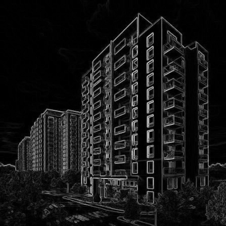
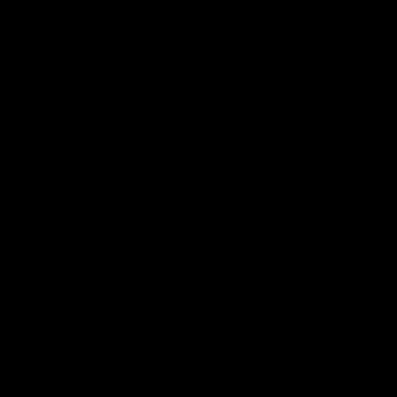
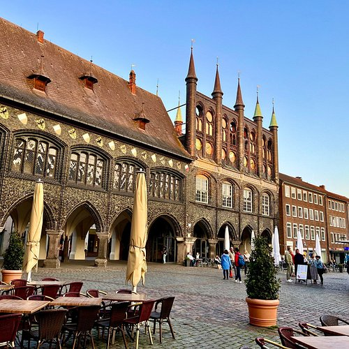
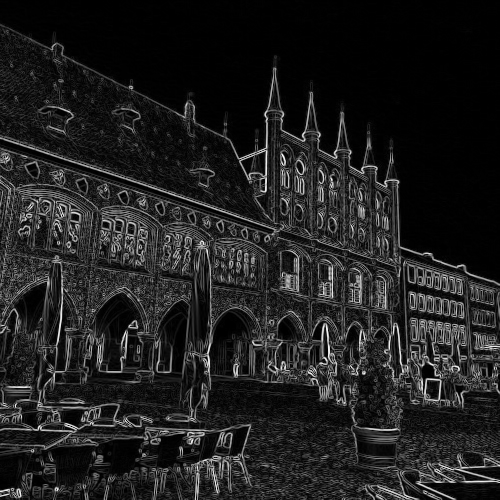

# Лабораторная работа №1. Оператор Собеля

| Табельный номер | ФИО | Группа | Вариант |
| :-------------: | ------------------ | :----: | :-----: |
| 563798 | Гребенщиков Д. А. | Р4140 | 1 |

## Цель работы

Реализовать оператор Собеля двумя способами:

1. С помощью готовой функции OpenCV.
2. Вручную на Python с последовательной обработкой каждого пикселя.

После этого нужно сравнить результаты и время работы обеих реализаций.

## Краткая теория

Изображение переводится в оттенки серого. Каждый пиксель хранит значение яркости от 0 до 255. Значение 0 соответствует чёрному цвету, 255 соответствует белому.

Граница находится там, где яркость соседних пикселей резко меняется. Оператор Собеля оценивает это изменение по двум направлениям.

Ядро для вычисления градиента по оси X:

```text
-1  0  1
-2  0  2
-1  0  1
```

Ядро для вычисления градиента по оси Y:

```text
-1 -2 -1
 0  0  0
 1  2  1
```

`Gx` показывает изменение яркости слева направо. `Gy` показывает изменение яркости сверху вниз. Общая сила границы вычисляется по формуле:

```text
G = sqrt(Gx² + Gy²)
```

`Gx` и `Gy` показывают изменение яркости в двух перпендикулярных направлениях. Общая сила границы является длиной вектора из этих двух компонентов, поэтому она вычисляется по теореме Пифагора. Квадраты убирают знак направления, а результат показывает только силу изменения яркости.

Чем больше значение `G`, тем сильнее граница в этой точке изображения.

## Алгоритм работы

1. Открыть изображение в оттенках серого.
2. Добавить рамку шириной один пиксель.
3. Для каждого пикселя взять область размером 3 на 3.
4. Умножить эту область на ядра Собеля.
5. Получить значения `Gx` и `Gy`.
6. Вычислить общую силу границы.
7. Привести результат к диапазону от 0 до 255.
8. Сохранить полученное изображение.

Для рамки используются копии крайних пикселей. В ручной реализации это `np.pad` с режимом `edge`. В OpenCV используется `BORDER_REPLICATE`. Одинаковая обработка краёв нужна для корректного сравнения результатов.

## Реализация

### OpenCV

Библиотечная версия использует функцию `cv2.Sobel`. Она отдельно вычисляет градиенты `Gx` и `Gy`, после чего они объединяются по общей формуле.

```python
gradient_x = cv2.Sobel(
    image, cv2.CV_32F, 1, 0,
    ksize=3,
    borderType=cv2.BORDER_REPLICATE,
)
gradient_y = cv2.Sobel(
    image, cv2.CV_32F, 0, 1,
    ksize=3,
    borderType=cv2.BORDER_REPLICATE,
)
gradient = np.sqrt(gradient_x**2 + gradient_y**2)
```

### Ручная версия

Ручная версия проходит по каждому пикселю двумя циклами. Для текущего пикселя берётся окно 3 на 3. Оно поэлементно умножается на каждое ядро Собеля. Полученные значения складываются.

```python
for y in range(height):
    for x in range(width):
        window = padded[y : y + 3, x : x + 3]
        gradient_x[y, x] = np.sum(window * KERNEL_X)
        gradient_y[y, x] = np.sum(window * KERNEL_Y)
```

Полная реализация находится в файле [`main.py`](main.py).

## Структура проекта

```text
lab1-sobel/
├── images/          исходные изображения
├── results/         результаты обработки
├── main.py          реализация оператора Собеля
├── requirements.txt зависимости проекта
└── README.md        описание работы
```

## Установка и запуск

Для работы использовались Python 3.9.6, OpenCV 4.14.0 и NumPy 2.0.2.

Создание окружения и установка зависимостей:

```bash
python3 -m venv .venv
source .venv/bin/activate
pip install -r requirements.txt
```

Запуск программы:

```bash
python main.py images/image.jpeg
```

После запуска в папке `results` создаются три файла:

- результат OpenCV
- результат ручной реализации
- разница между результатами

## Результаты

### Изображение 1

| Исходное изображение | OpenCV | Ручная версия | Разница |
|---|---|---|---|
|  |  |  |  |

### Изображение 2

| Исходное изображение | OpenCV | Ручная версия | Разница |
|---|---|---|---|
|  |  |  |  |

### Изображение 3

| Исходное изображение | OpenCV | Ручная версия | Разница |
|---|---|---|---|
|  |  |  |  |

## Сравнение времени

Каждая функция запускалась один раз для прогрева и три раза для измерения. В таблице указано среднее время одного запуска.

| Изображение | Размер | OpenCV, мс | Ручная версия, мс | Ускорение OpenCV |
|---|---:|---:|---:|---:|
| `image.jpeg` | 500 на 500 | 0.521 | 1159.668 | 2224.8 раза |
| `image_2.jpeg` | 447 на 447 | 0.444 | 911.473 | 2054.3 раза |
| `image_3.jpg` | 500 на 500 | 0.531 | 1151.083 | 2168.7 раза |

OpenCV обработал каждое изображение меньше чем за одну миллисекунду. Ручной обработке потребовалось примерно от 0.9 до 1.2 секунды.

Средняя разница между соответствующими пикселями во всех трёх случаях равна `0.000`. Это означает, что ручная и библиотечная реализации дали одинаковый результат. Поэтому изображения разницы полностью чёрные.

Большая разница во времени связана с тем, что ручная версия выполняет два цикла Python и отдельно обрабатывает каждый пиксель. OpenCV выполняет те же основные вычисления в оптимизированном скомпилированном коде.

## Вывод

В работе я реализовал оператор Собеля вручную и с помощью OpenCV. Обе версии правильно выделили участки с резким изменением яркости. Результаты полностью совпали, что подтверждает корректность ручной реализации.

OpenCV оказался примерно в 2000 раз быстрее. Для практической обработки изображений лучше использовать библиотечную реализацию. Ручная версия позволяет понять последовательность вычислений и принцип работы оператора Собеля.

Ручную реализацию тоже можно ускорить. Для этого можно заменить циклы Python векторными операциями NumPy, скомпилировать циклы с помощью Numba, разделить двумерные ядра Собеля на последовательные одномерные проходы или обрабатывать независимые строки параллельно. В данной работе эти оптимизации не использовались, так как основной задачей была наглядная ручная реализация алгоритма.

Способ заполнения краёв выбирается под конкретную задачу. Края можно заполнить постоянным значением, скопировать, отразить или зациклить. Этот выбор влияет на результат возле границы изображения и может создавать нежелательные контуры. В работе использовано копирование крайних пикселей. Оно не создаёт резкого перехода к нулю и позволяет получить одинаковый результат в обеих реализациях.

## Источники

1. [OpenCV. Sobel Derivatives](https://docs.opencv.org/4.x/d2/d2c/tutorial_sobel_derivatives.html)
2. [NumPy. Функция pad](https://numpy.org/doc/stable/reference/generated/numpy.pad.html)
3. [OpenCV. Типы заполнения границ](https://docs.opencv.org/4.13.0/d2/de8/group__core__array.html)
4. [NumPy. Sliding window view](https://numpy.org/doc/stable/reference/generated/numpy.lib.stride_tricks.sliding_window_view.html)
5. [Numba. Рекомендации по оптимизации](https://numba.readthedocs.io/en/stable/user/performance-tips.html)
